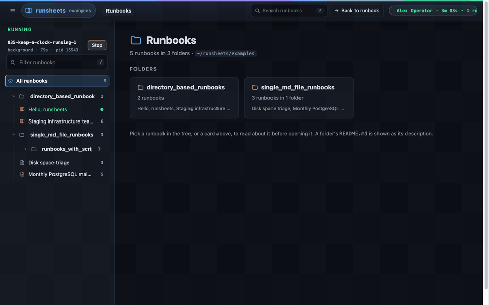
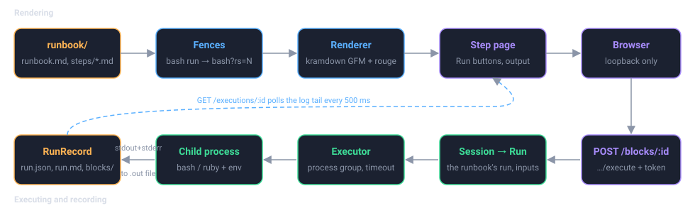

<p align="center">
  
</p>

# runsheets

<p class="hero-tagline">Runbooks you can run. Runs you can prove.</p>

Write the procedure in plain markdown. runsheets serves it as a page with a
**Run** button on every command you marked, checks the output against what
you expected, makes the operator confirm each manual and destructive step,
and records all of it. The result is a record of what was actually done,
not scrollback in a terminal that's already closed.

[Get started :material-arrow-right:](getting-started.md){ .md-button .md-button--primary }
[Why runsheets?](why-runsheets.md){ .md-button }
[See the examples](examples.md){ .md-button }

{ .screenshot }

---

**Executable runbooks.** A runbook (a directory of markdown files, or a
single markdown file) becomes a local web
page where the steps read like a doc site, the commands the author marked as
runnable get a Run button, and everything that happens during a run is
recorded: the exact command, its output, exit status, timing, and the
operator's acknowledgements of the manual steps. Everything between starting
and stopping `runsheets` is one session, with a log written as it happens.

The rendering is the vehicle. The run record, the *runsheet*, is the point.

<div class="diagram" markdown>

</div>

## Why

Operational runbooks are prose with commands in them. An operator reads a
step, copies the command into a terminal, eyeballs the output, and moves on.
Nothing records what was run, what came back, or who confirmed the manual
steps. Authoring guides ask operators to "test the runbook by following it"
and to "date the last verification" by hand, and neither happens reliably.

runsheets closes that gap:

- The runbook renders as HTML, so it reads as well as any doc site.
- Fenced blocks the author marks as executable get a Run button.
- Every execution and its output is captured, in order, into a run record,
  and every action into the session log.
- Manual steps are acknowledged by the operator and that acknowledgement is
  recorded.
- The record lives outside the runbook, so captured output never lands next
  to the docs in a repository.

## What it is not

- **Not a remote execution service.** It is a script an operator starts on
  their own machine, with their own shell environment, credentials, SSO
  sessions and tunnels. It binds to loopback and has no multi-user story.
- **Not a workflow engine.** Steps are visited in order but the operator can
  jump around. The record keeps the real sequence, so skipping is visible
  rather than prevented.
- **Not a replacement for reading.** Blocks run only when the author opted
  them in and the operator clicked. Everything else is inert text.

## Quick start

```bash
gem install runsheets
cd "$(dirname "$(gem which runsheets)")/.."                         # the installed gem's directory
runsheets --open examples/directory_based_runbooks/hello            # a runbook directory
runsheets --open examples/single_md_file_runbooks/db-maintenance.md # a single all-in-one file
runsheets --open examples                                           # or choose from all of them
```

The example runbook is safe to run end to end. Say who you are and why on
the start page, click Start run, click Run on the first step, mark it done,
and look at the run record that appears under
`~/.local/share/runsheets/runs/hello/`.

## Where to go next

<div class="grid cards" markdown>

- **[Why runsheets](why-runsheets.md)**

    The problem it solves, who it is for, and how it compares with a wiki
    page or a shell script.

- **[Getting Started](getting-started.md)**

    Install, run the examples, and walk through a complete session.

- **[Example Runbooks](examples.md)**

    Five bundled runbooks, from a safe tour of every block kind to a
    realistic AWS teardown.

- **[Writing Runbooks](runbooks/index.md)**

    The directory layout, front matter, the fenced block convention, inputs
    and secrets.

- **[Running](running/index.md)**

    The command line, the web page, the execution model, and what the
    session and run records contain.

- **[Reference](reference/security.md)**

    Security posture, architecture, the Ruby API, and the HTTP endpoints.

- **[runsheets + asgard](asgard.md)**

    Keep long or reusable scripts as asgard tasks beside the runbook, and
    each block can be one line.

</div>

## Status

Built and working: rendering,
executing `bash`, `ruby` and any mapped language such as `sql`, background
processes with Start and Stop, destructive confirmation, terminal and
manual acknowledgements, expected-output panels, secret redaction, a
Checks page, run history with drift, single-file runbooks, a scaffold
command, realistic sample runbooks, and sessions: one engineer, a reason,
notes, many runbooks, and a log of everything. The block
convention is settled unless real use argues otherwise.
