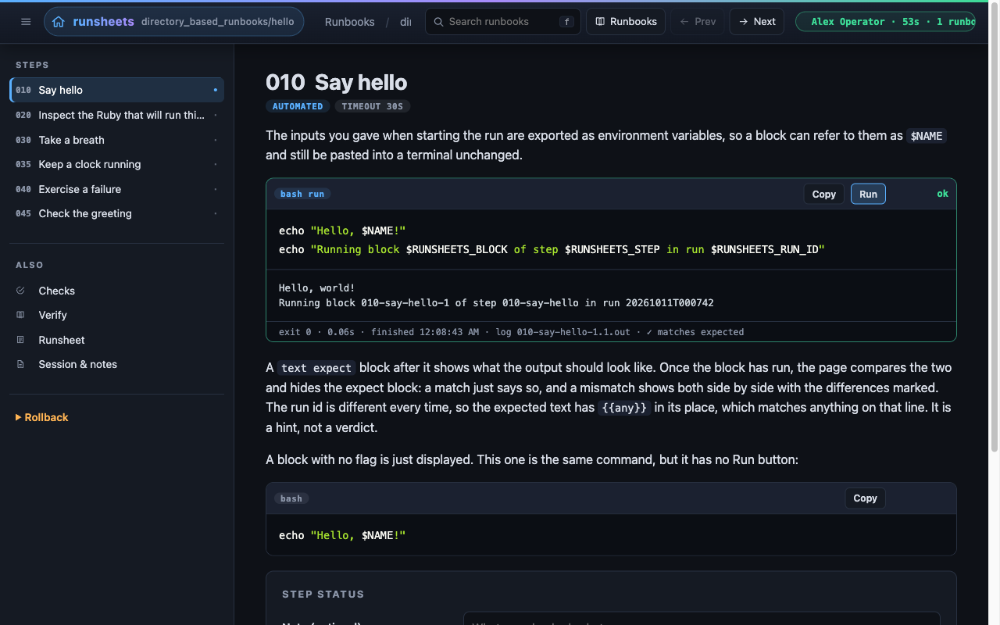

---
tags:
  - Getting started
  - Security
---

# Why runsheets

**Your runbook already says what to do. runsheets runs it with you and
writes down what happened.**

## The 2 a.m. problem

The database is filling up. The on-call engineer finds the runbook on the
wiki, last edited eleven months ago, and starts copying commands into a
terminal. Step 3 prints something that doesn't look like the example. Was
that expected? They carry on. Step 5 is "confirm the replica has caught up",
and they think it has. An hour later the incident is closed, and the only
evidence of what was actually run is scrollback in a terminal that is
already gone.

Next month someone does the same thing, and nobody knows whether the
runbook still works until they're halfway through it.

runsheets is for that gap between the runbook and the run.

{ .screenshot loading=lazy }

## What you get

<div class="grid cards" markdown>

- :material-file-document-outline: **Runbooks stay markdown**

    ---

    No new format. A runbook is a folder of markdown files, or one file
    whose `##` headings are the steps. It still reads fine on GitHub and in
    your editor, and it diffs cleanly in a pull request.

- :material-play-circle-outline: **A Run button where the author asked for one**

    ---

    Add `run` after the language on a fence (` ```bash run `) and that block
    gets a Run button. Blocks without it are only text. Nothing runs unless
    the author marked it and the operator clicked it.

- :material-clipboard-text-clock-outline: **A record of every run**

    ---

    Every execution is saved in order: the exact command, its output, exit
    status, timing, and each manual step the operator acknowledged. That
    record is the *runsheet*, and it is kept outside the repository.

- :material-compare: **Expected output, checked for you**

    ---

    Put a ` ```text expect ` block under a command and runsheets compares
    the real output against it, with `{{any}}` wildcards for the parts that
    change. A mismatch is shown as a diff, not left to whoever happens to be
    reading the output.

- :material-alert-octagon-outline: **Guard rails for dangerous steps**

    ---

    A `destructive` block won't run until the operator types the
    confirmation code it shows. A `terminal` block is one the operator runs
    in their own shell and then confirms. A `background` block (a tunnel, a
    tail) gets Start and Stop buttons.

- :material-key-variant: **Inputs and secrets**

    ---

    Front matter declares inputs, and they become a form when a run starts.
    Values reach blocks as environment variables, so `$AWS_PROFILE` works in
    the browser and when pasted into a terminal. Secret inputs are masked
    and redacted from the record.

- :material-history: **History and drift**

    ---

    Every runbook lists its earlier runs. Open an old run and any block
    that has changed or been removed since then is flagged, with a diff
    against the code that actually ran.

- :material-notebook-edit-outline: **Sessions and a live log**

    ---

    One sitting is one session: who, why, notes, and every runbook touched.
    Each action and each line of output goes to a session log as it happens,
    in a format you can `grep`.

</div>

## Who it's for

- **On-call engineers and SREs** who want incident procedures that can be
  run as written, with evidence of what was done.
- **Platform and infrastructure teams** with long, risky procedures such as
  teardowns, rebuilds, failovers and migrations, where a skipped step costs
  real money.
- **Anyone with monthly chores**, like database maintenance, disk triage or
  certificate rotation: work you do rarely enough to forget, but often
  enough to want written down.
- **Teams that answer to auditors.** "Show me what was run during the
  change window" becomes a file you can send.

## Wiki page, shell script, or runsheets?

| | Wiki runbook | Shell script | runsheets |
| --- | :---: | :---: | :---: |
| Explains *why* each step exists | yes | rarely | yes |
| Operator can stop and look between steps | yes | no | yes |
| Commands run exactly as written | no (copy/paste) | yes | yes |
| Output checked against what was expected | no | only if you write it | yes, `expect` blocks |
| Manual steps acknowledged and recorded | no | no | yes |
| Record of what actually happened | no | no | yes, every run |
| Runs with your own credentials, SSO sessions and tunnels | yes | yes | yes |

A wiki page explains well but records nothing. A script runs reliably but
hides its reasoning and won't stop for a human decision. runsheets keeps the
explanation and adds a recorded, step-at-a-time run.

## Safe by design

runsheets runs commands, so its defaults are cautious:

- It binds to **loopback** and runs as **you**, on your machine, with your
  shell environment. There's no server to deploy and no shared credentials
  to manage.
- Blocks are **opt-in**. Only fences the author marked get a button.
- Destructive blocks need a **typed confirmation**.
- Secrets are **masked** in the form and **redacted** from the record.
- Records are written **outside the runbook**, so captured output never
  lands in your docs repository.

The [Security Posture](reference/security.md) page has the full threat
model.

## Try it in two minutes

```bash
git clone https://github.com/MadBomber/runsheets
cd runsheets && bundle install
bin/runsheets --open examples
```

Pick **Hello, runsheets**. It uses every block kind and touches nothing on
your machine. Say who you are, click **Start run**, then click **Run**.
When you're done, look in
`~/.local/share/runsheets/runs/directory_based_runbooks/hello/` for the
runsheet you just produced.

[Get started :material-arrow-right:](getting-started.md){ .md-button .md-button--primary }
[Tour the examples](examples.md){ .md-button }

!!! tip "Pairs well with asgard"
    Keep long or reusable scripts in [asgard](asgard.md) task files beside
    the runbook, and each block can be a single line like
    `asgard health`.
